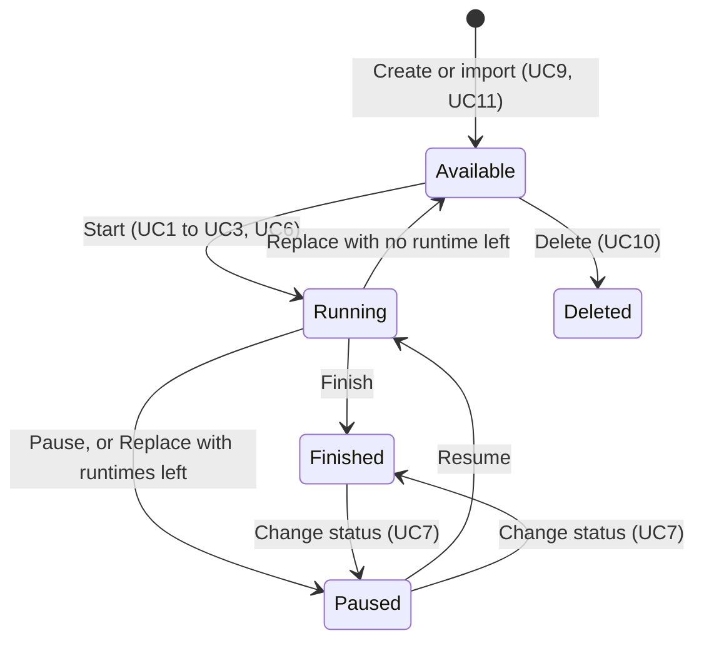

# Operator App (on-premise): functional specification

This spec is the single home of the Operator's business rules (`RN-`) and acceptance criteria (`AC-`).
Jira cards under PRODT-157 cite these IDs and never restate them. An approved version of this spec
outranks any inference from code, cards or chat.

Language: English. Shop-floor terms keep the Portuguese the operator sees, in quotes, on first use.

## Problem

The Operator is the shop-floor app operators use to run production orders (POs) and classify downtime
on each line. The product ships as an **on-premise app installed at each factory for one customer**;
the cloud Operator is stopped.

QA between 7 and 12 October 2026 (Vinícius, cloud staging and sandbox) showed the core flows work,
but three defects block a factory rollout:

1. Creating a new PO inside Change PO fails with a server error on every line tested.
2. The offline queue treats server refusals as lost connections: the operator sees "Success", the
   refusal surfaces days later, and one failure blocks every later action on the tablet.
3. The Events tab lists machine stops alongside line stops and shows only the first 20 pending stops.

Wrong PO times, wrong downtime attribution or hidden pending stops produce plausible but wrong OEE,
which is why this spec is tier **large** (industrial data correctness).

## Expected behaviour

### Environments

| Environment | Enterprise | Use |
| --- | --- | --- |
| Pack4 production | C-PACK (1) | Source of truth for expected behaviour |
| CPACK-Staging | 3 | Read-only mirror of production. Writes refused with `MIRROR_TENANT_WRITE_BLOCKED` |
| SANDBOX-CPACK | 2000003 | Where write flows are tested. Resettable clone of CPACK-Staging |

Addresses: Operator on the sandbox `operator-sbx.staging.packiot.app`; `operator.staging.packiot.app` is
CPACK-Staging (read-only). The sandbox resets completely to CPACK-Staging (POs, stops, configuration,
barcode scans) 4 hours after the last change, and nightly at 06:00 UTC unless held. QA guide (logins,
how to extend a hold, gotchas): [Sandbox for testing](https://wiki.packiot.app/use/sandbox-for-testing/).

### Feature catalogue

| Area | Feature | Rules | Criteria |
| --- | --- | --- | --- |
| App shell | Login and logout | | AC-39 |
| App shell | Top bar: logo, enterprise selector (cloud only), user, logout | RN-04 | AC-39 |
| App shell | Sidebar: areas and lines, switch line | RN-01, RN-02 | AC-01, AC-02 |
| App shell | Landing line after login | RN-03 | AC-03, AC-04 |
| App shell | Read-only behaviour on mirror tenants | RN-05 | AC-05 |
| Production tab | PO header (PO number, customer, product, operator) | | |
| Production tab | Summary chart: order size, produced, scrap (with % of total) | RN-14 | AC-15 |
| Production tab | Time block: start, duration, downtime (with % of duration) | RN-14 | AC-15 |
| Production orders | UC1 to UC13, see below | RN-06 to RN-15 | AC-06 to AC-16 |
| Events tab | Pending list, history list, badge | RN-16, RN-17 | AC-17 to AC-19 |
| Events tab | Configurable time window (CS Admin) | RN-18 | AC-20, AC-21 |
| Downtime | Justify | RN-10, RN-19 | AC-22, AC-23, AC-27 |
| Downtime | Split | RN-10, RN-20 | AC-24, AC-25, AC-27 |
| Downtime | Manual downtime: create, edit | RN-10, RN-21 | AC-26, AC-27, AC-28 |
| Shared | Time picker | RN-23 | AC-29 |
| Shared | Error messages | RN-25 | AC-30 |
| Offline | Sync queue, badge, pending list | RN-24 | AC-31 to AC-36 |
| Platform | Audit trail | RN-15 | AC-14 |
| Platform | Line-level stops for C-PACK | RN-16 | AC-37 |

The desktop app (front4) Downtimes page shares Justify and Split behaviour; the rules apply to both (AC-38).

### Production order use cases

| UC | Use case | Screen | Endpoint (edge-api) |
| --- | --- | --- | --- |
| UC1 | Start an existing PO on an idle line | Operator, Select PO | `POST /api/production-orders/start` |
| UC2 | Create and start a PO on an idle line | Operator, Select PO | `POST /api/production-orders/create-and-start` |
| UC3 | Change PO: finish or pause the current PO, start an existing one | Operator, Change PO | `POST /api/production-orders/setup` |
| UC4 | Change PO: finish or pause, no new PO | Operator, Change PO | `POST /api/production-orders/setup` |
| UC5 | Change PO: finish or pause, create a new PO | Operator, Change PO | `POST /api/production-orders/setup` |
| UC6 | Replace the PO on the open runtime (wrong PO picked, or placeholder PO replaced by the real one) | Operator, PO header | `POST /api/production-orders/replace` (+ `create`) |
| UC7 | Swap status between paused and finished | Desktop | `POST /api/production-orders/change-status` |
| UC8 | Edit a runtime's start and end | Desktop | `POST /api/production-orders/change-time` |
| UC9 | Create a PO without starting it | Desktop; Operator inside UC6 | `POST /api/production-orders/create` |
| UC10 | Delete POs that never started | Desktop | `POST /api/production-orders/delete` |
| UC11 | Import or validate POs from CSV | Desktop, admin | `POST /api/admin/production-orders/csv/{import,validate}` |
| UC12 | Read the current PO | All apps | `GET /api/production-orders/current` |
| UC13 | PO control from the machine (start, stop, setup signals) | Node-RED and worker | PackML parameters 30800 to 30899 |

Change PO is a three-step flow: (1) confirm the current PO's real quantity produced; (2) choose the next
PO (existing, new, or "Finish without a new PO"), its start time, and whether the current PO is finished
or paused; "Enable other options" allows taking a PO from another line or creating one; (3) confirm the
report.

PO lifecycle (stored status codes): Available `1`, Running `2`, Finished `3`, Paused `4`.

### Events tab

Two timelines: pending stops waiting for a reason, then the history of justified stops. The tab name
shows the pending count. Only the line's own stops appear.

Behaviour today (for reference; the rules below replace it): pending = unjustified stops started in the
last 4 days; history = justified stops started in the last 7 days and ended in the last 24 hours; both
newest first; the Operator keeps only the first 20 pending and 50 history rows; windows are hard-coded
in `serving.pending_downtime` and `serving.events_timeline`.

### Downtime features

| Feature | Endpoint (edge-api) |
| --- | --- |
| Justify | `POST /api/downtimes/justify` |
| Split | `POST /api/downtimes/split` |
| Create manual downtime | `POST /api/downtimes/create-manual-event` |
| Edit manual downtime | `POST /api/downtimes/edit-manual-event` |
| Delete manual downtime | `POST /api/downtimes/delete-manual-event` (exists; not offered in the Operator, RN-21) |

### Offline sync

The Operator keeps working without a connection: actions are stored on the tablet and sent when the
connection returns. Only connectivity failures belong in that queue (RN-24).

## Scope

In scope: the Operator app (pack-alpha generation, component `operator`) and the edge-api, read API and
database behaviour it depends on; the CS Admin setting for the Events time window.

Out of scope: the desktop app beyond the shared Justify and Split rules; the stable-generation Operator
(`operator4`); PO runs on several lines (ADR-0023); planned stops scheduled in the future (discovery).

## Business rules

- **RN-01**: Sidebar order is natural sort (case-insensitive, numbers compared as numbers): areas first, then equipment within each area. Example: CELULA1, CELULA2, CELULA9, LINHAS, SLEEVE; L3, L4, L5, L6, L8, L10.
- **RN-02**: A user sees and acts only on lines they are permitted to access. Areas with no permitted line are hidden. The server enforces the same rule.
- **RN-03**: On login the Operator opens the last line the user viewed (stored per user and per enterprise on the server), if still permitted; otherwise the first permitted line in sidebar order; with no permitted line, an empty state with the language-pack message "You do not have access to any line yet. Ask your administrator to update your permissions."
- **RN-04**: The enterprise switch exists only in cloud staging and sandbox. The on-premise Operator serves one customer and has no enterprise switch.
- **RN-05**: On a mirror tenant (CPACK-Staging, enterprise 3) every write is refused; the Operator shows write actions as disabled, with a note to use the sandbox.
- **RN-06**: PO lifecycle: Available to Running; Running to Paused or Finished; Paused to Running; Paused and Finished swap only through UC7; only Available POs can be deleted.
- **RN-07**: A line runs at most one PO at a time.
- **RN-08**: Runtimes on the same line never overlap.
- **RN-09**: PO numbers are unique per enterprise and may be alphanumeric (for example "ORD-7").
- **RN-10**: No time in the future, in any time input of the Operator: PO start, Justify, Split, manual downtime create and edit.
- **RN-11**: A PO start may be back-dated by at most 24 hours, and never into another PO's runtime on the same line.
- **RN-12**: An action is refused when the running PO changed since the operator chose it; the Operator explains why.
- **RN-13**: Replace: the displaced PO becomes Available when no runtime remains, Paused when at least one does. The new PO becomes Running only when the moved runtime is open.
- **RN-14**: Replace: the operator chooses which runtimes move (the open one preselected). Downtime, scrap and manual events follow their runtime. PO produced, scrap and downtime are computed from the PO's own runtime windows, not from its first-start-to-last-end span.
- **RN-15**: Audit: every write is recorded in the same transaction as the change, with who (verified user and role), when (UTC), where (enterprise, site, line), what (action type) and the before and after values needed to reverse it. Entries are append-only. Replace is the first action to meet this; every other write follows.
- **RN-16**: The Events tab lists only stops recorded on the line itself, never stops recorded on its machines, whether or not a PO was running.
- **RN-17**: Pending = stops with no reason that last at least the line's minimum stop time, or are ongoing. History = stops with a reason. Both sorted by start time, newest first. Every stop in the window is reachable; the tab badge counts exactly the stops the pending list can show.
- **RN-18**: Each enterprise sets, in CS Admin, a time window for the pending list and another for the history list: current shift, current production day, or the last N hours. The window applies to a stop's start time. An ongoing stop always appears in the pending list. The window never exceeds 7 days. Shift and production-day windows follow the area's shift calendar.
- **RN-19**: Justify: the Machine field lists only the current line ("Geral - Linha") and that line's own machines. Category is mandatory; when the category has subcategories, a subcategory is mandatory too.
- **RN-20**: Split: the split time lies strictly between the stop's start and end; it defaults to one minute after the stop's start; for an ongoing stop the latest choice is now. The parts cover the original stop exactly. The split time is the only time an operator can choose on an automatic stop.
- **RN-21**: Manual downtime: end after start; never overlapping another stop on the same equipment. Only manual stops can have their times edited. Operators cannot delete a manual stop.
- **RN-22**: Stops on the same equipment never overlap, and at most one is open at a time.
- **RN-23**: One time picker across the Operator: hours and minutes only (seconds sent as :00), one format per language.
- **RN-24**: Offline sync: only lost connections, timeouts and 502, 503, 504 responses are queued. Any other refusal while online is shown at once and never queued. Queued actions replay in order per line; a failed action holds back only later actions on the same line. The sync badge sits below the top bar, shows waiting and failed counts, and disappears when everything has synced. The operator can open the pending list and keep or discard each action. "Success" is shown only after the server confirms. An action older than the end of its shift needs supervisor permission to apply. "Apply as time-correction" shows what will change before confirming.
- **RN-25**: When the server refuses an action with a reason, the Operator shows that reason. No input to any endpoint produces a 500.

## Acceptance criteria

### App shell

- **AC-01**: Given an enterprise with areas LINHAS, CELULA1, CELULA2, CELULA9 and SLEEVE, when the sidebar opens, then areas show as CELULA1, CELULA2, CELULA9, LINHAS, SLEEVE and the lines in LINHAS as L3, L4, L5, L6, L8, L10. (RN-01)
- **AC-02**: Given a user permitted only on L4, when they open the Operator or request L5's address directly, then only L4 appears and no L5 data is returned. Negative case. (RN-02)
- **AC-03**: Given a user who last viewed L6 and is still permitted on it, when they log in on any tablet, then the Operator opens on L6. (RN-03)
- **AC-04**: Given a user whose last line is no longer permitted, when they log in, then the first permitted line opens with no error; given a user with no permitted line, then the empty-state message from the language pack is shown. (RN-03)
- **AC-05**: Given the CPACK-Staging tenant, when the operator opens Justify, Split, Change PO or Replace, then the action is disabled with a note to use the sandbox and no write request is sent. Negative case. (RN-05)
- **AC-39**: Regression guard: login, logout, line switching and (cloud only) the enterprise switch keep working as tested on 12 Oct 2026. (RN-04)

### Production orders

- **AC-06**: Given a running PO on a line, when the operator runs Change PO creating a new PO number and pausing the current PO, then the response is 201, the old PO is Paused and the new PO is Running from the chosen time. (UC5)
- **AC-07**: Same as AC-06 with finish instead of pause: the old PO is Finished. (UC5)
- **AC-08**: Given a PO number already used in the enterprise, when it is entered as a new PO, then the response is 400 with a message naming the conflict. No input to `setup` returns a 500. Negative case. (RN-09, RN-25)
- **AC-09**: Regression guard: Change PO finishing or pausing with no new PO (UC4) and Change PO to an existing PO (UC3) keep working.
- **AC-10**: Given a running PO, when a new PO start is set more than 24 hours back, or inside another PO's runtime on the line, then the change is refused with a message. Negative case. (RN-11)
- **AC-11**: Given any PO start input, when a time after now is chosen, then the picker does not offer it and the server refuses it. Negative case. (RN-10)
- **AC-12**: Given the server reports a running PO on a line, when the operator opens the line, then that PO is shown with the option to finish or pause it; the operator is never left with "No Production Order selected yet" and a refused start. (RN-07)
- **AC-13**: Given a closed runtime moved by Replace, when the replacement completes, then the new PO is not set to Running. (RN-13)
- **AC-14**: Given a Replace, when it succeeds, then one audit entry exists, written in the same transaction, with the verified user, old PO, new PO, runtimes moved, and produced totals of both POs before and after; when it fails, neither the change nor an audit entry exists. (RN-15)
- **AC-15**: Given a PO with runtimes R1, R2 and R3, when the operator replaces R2 only, then R2 and the stops, scrap and manual events inside it move to the new PO, and each PO's produced, scrap and downtime equal the sums over its own runtimes. (RN-14)
- **AC-16**: Given the PO number "ORD-7", when it is created, started, changed and replaced, then every step succeeds and the number displays unchanged. (RN-09)

### Events tab

- **AC-17**: Given L5, whose machines also record stops, when the Events tab opens, then only stops recorded on L5 itself are listed. Negative case: no machine stop appears. (RN-16)
- **AC-18**: Given 39 pending stops in the window, when the operator scrolls the pending list, then all 39 are reachable and the badge shows 39. (RN-17)
- **AC-19**: Given a pending stop, when it is justified, then it leaves the pending list, appears in the history and the badge drops by one, without a reload. (RN-17)
- **AC-20**: Given a window of "current shift", when the tab opens, then it lists the stops that started in the current shift, plus any ongoing stop that started earlier. (RN-18)
- **AC-21**: Given a CS Admin user, when they set a window longer than 7 days, then the setting is refused. Negative case. (RN-18)
- **AC-37**: Given C-PACK L3, when its machines stop, then line-level stops exist for L3 so its Events tab is not empty under RN-16. (RN-16)

### Downtime

- **AC-22**: Given a pending stop on L5, when Justify opens, then the Machine list holds "Geral - Linha" and L5's own machines only. Negative case: no machine from another line. (RN-19)
- **AC-23**: Given Justify with a category that has subcategories, when no subcategory is chosen, then Confirm stays disabled; with a category that has none, Confirm is enabled once the category is set. (RN-19)
- **AC-24**: Given a stop from 05:40 to 05:46, when Split opens, then the picker defaults to 05:41 and offers only times strictly between 05:40 and 05:46; for an ongoing stop, nothing after now. (RN-20)
- **AC-25**: Given a split whose parts do not cover the stop exactly, when submitted, then it is refused with a message and nothing changes. Negative case. (RN-20)
- **AC-26**: Given an automatic stop from 10:00 to 10:20, when a manual stop from 10:10 to 10:30 is created on the same equipment, then it is refused with a message. Negative case. (RN-21, RN-22)
- **AC-27**: Given Justify, Split or a manual stop, when a time after now is entered, then it is not offered and the server refuses it. Negative case. (RN-10)
- **AC-28**: Given an automatic stop, when Edit opens, then its times are read-only; given a manual stop, its times can be edited. (RN-21)
- **AC-38**: Regression guard: Justify and Split on the desktop Downtimes page follow the same rules and keep working.

### Shared UI

- **AC-29**: Given any time input in the Operator, when the picker opens, then it shows hours and minutes only and uses the same component as every other time input. (RN-23)
- **AC-30**: Given a server refusal with a message (for example "Cannot start an order without finish the current one!"), when it happens, then the Operator shows that message, not "Oops! An error occurred.". (RN-25)

### Offline sync

- **AC-31**: Given the tablet is online, when the server answers 400, 403, 404, 409 or 500, then the error shows at once, the action is not queued and the screen returns to the server's state. Negative case. (RN-24)
- **AC-32**: Given the tablet is offline, when the operator acts and the connection returns, then the action replays and "Success" appears only after the server confirms. (RN-24)
- **AC-33**: Given a failed action on L4, when the operator acts on L5, then the L5 action is sent without waiting. (RN-24)
- **AC-34**: Given waiting or failed actions, when the operator opens the pending list, then each can be kept or discarded; after a discard the screen shows the server's state. (RN-24)
- **AC-35**: Given waiting actions, then the badge sits below the top bar with waiting and failed counts, never covers the plus button, and disappears when everything has synced. (RN-24)
- **AC-36**: Given a parked action, when "Apply as time-correction" is chosen, then the PO, time span and production that would move are shown before confirming; an action older than the end of its shift needs supervisor permission. (RN-24)

## Non-functional requirements

- **NFR-01**: Events queries keep a literal time bound so the database prunes old chunks; an unbounded version caused 15-second timeouts (`t-events-timeline-bound`).
- **NFR-02**: The Operator works offline for at least one shift without losing an action.
- **NFR-03**: Every user-facing string comes from the language pack (pt-BR and en-US at minimum).

## Contracts

The endpoints are listed above. Known contract issues to fix under this Epic:

- `setup`: the Operator sends the typed PO number in `idProductionOrder` and never sends `shouldCreatePo` when creating a PO (AC-06, AC-07).
- `setup` and `create-and-start` type `idOrder` as a number; alphanumeric numbers need a text contract (AC-16, ADR-0062 migrations).
- `replace` accepts a closed runtime and still sets the new PO to Running (AC-13).
- The audit middleware writes after the response, outside the transaction, and takes the user from the `x-user` header (AC-14).

## Observability

- Every refused write is logged with its reason and visible in the server log (supports AC-30, AC-31).
- The `user_logs` table holds the audit trail (AC-14).
- Data invariants: unjustified downtime minutes per line and shift (proposed metric for RN-18).

## Risks and rollback

- **Hiding pending stops by window** leaves them permanently unclassified in reports. Mitigation proposed: a grace period after shift change and a supervisor view of unjustified stops.
- ~~**Line-only Events (RN-16) empties L3** until AC-37 is met.~~ Resolved 2026-10-16: L3 has line stops (see OQ-02).
- **CPACK-Staging data from 8 Oct 2026** carries test writes made before the mirror block; do not use it as a clean baseline for L3 to L6.
- Rollback: every change ships behind the sprint release; the PO staleness gate is already feature-flagged per tenant.

## Open questions

- **OQ-01**: One line per PO: not enforced today; left open until ADR-0023 decides whether a PO may run on several lines. Owner: Vinícius.
- **OQ-02**: What produces C-PACK L3 line-level stops now that the legacy mirror no longer does (AC-37)? Deprioritised; blocks RN-16 on L3. Owner: Vinícius.
  - **Answered 2026-10-16 (PRODT-176 spike, staging data, read-only):** the premise no longer holds. L3 (equipment 48)
    has line-level stops every day since 3 Oct — 14 to 30 a day (17 on 16 Oct, last at 16:29 UTC), from the legacy
    mirror path. The empty days seen on 7 Oct match the legacy oeecloud VM migration (cutover 5 Oct) and the switch of
    C-PACK events to PubSub (6–7 Oct); those days were back-filled. **AC-37 is met today** and RN-16 does not empty L3.
  - **Residual risk:** the new-stack C-PACK event deriver (shadow mode, `silver.equipment_events_cpac_shadow`) produces
    line stops for every L-line except L3 since 3 Oct (164 L3 rows in total, all older). If the legacy path breaks
    again nothing covers L3. Follow-up before C-PACK's own go-live: find why the deriver stopped emitting for L3
    (lead machine 58 L3-BREYER) and make it cover L3.

This spec stays `in-review` until both are answered.

## Decisions log

| Date | Decision |
| --- | --- |
| 2026-10-12 | The product is the on-premise Operator; cloud Operator work stopped (PRODT-17, PRODT-52) |
| 2026-10-12 | Events tab: line stops only, newest first, window applies to start time, configurable per enterprise |
| 2026-10-12 | Justify field rules (RN-19); Split default start plus one minute (RN-20); manual stops not deletable (RN-21) |
| 2026-10-12 | No future time anywhere (RN-10); back-dating at most 24 hours without overlap (RN-11) |
| 2026-10-12 | Sync badge below the top bar; keep or discard pending actions (RN-24) |
| 2026-10-12 | Audit: Replace first, then every write (RN-15) |
| 2026-10-08 | Replace: selective runtimes, downtime follows runtime, old PO available or paused (RN-13, RN-14) |
| 2026-10-08 | Landing line and natural sort (RN-01, RN-03) |
| 2026-10-07 | Stops on the same equipment never overlap (RN-22) |

## Backlog index

Cards cite the criteria; this table only links them. Spikes are Tasks labelled `discovery`. "Card-local" means the criteria live on the card because the spec does not cover that item. Sprint 7 (due 24 Oct 2026): PRODT-158 to PRODT-166.

| Jira | Type | Item | Criteria |
| --- | --- | --- | --- |
| PRODT-158 | Bug | Change PO: creating a new PO in the flow returns 500 | AC-06, AC-07, AC-08, AC-09 |
| PRODT-159 | Bug | Offline sync queues server refusals and hides their messages | AC-30, AC-31, AC-32, AC-33 |
| PRODT-160 | Story | Pending actions list: keep, discard and safe time-correction | AC-34, AC-35, AC-36 |
| PRODT-161 | Bug | Events tab shows only the first 20 pending stops while the badge counts all | AC-18, AC-19 |
| PRODT-162 | Bug | Events tab lists machine stops on the line | AC-17 |
| PRODT-163 | Bug | Operator shows no PO while the server has one running | AC-12, AC-30 |
| PRODT-164 | Task | Prepare SANDBOX-CPACK for write-flow testing | Card-local |
| PRODT-165 | Story | One time picker with the Operator's time rules | AC-11, AC-24, AC-27, AC-29 |
| PRODT-166 | Bug | PO start can be back-dated with no limit and into another PO's runtime | AC-10, AC-11 |
| PRODT-167 | Bug | Replace sets the new PO to Running when the moved runtime is closed | AC-13 |
| PRODT-168 | Story | Audit trail for Replace PO | AC-14 |
| PRODT-169 | Story | Replace PO: choose which runtimes move | AC-15 |
| PRODT-170 | Story | Configurable pending and history windows per enterprise | AC-20, AC-21 |
| PRODT-171 | Story | Justify, Split and manual stops follow the line and reason rules | AC-22, AC-23, AC-25, AC-26, AC-28, AC-38 |
| PRODT-172 | Story | Line permissions and landing line on login | AC-02, AC-03, AC-04 |
| PRODT-155 | Story | Operator sidebar: natural sort order of areas and lines | AC-01, AC-39 |
| PRODT-156 | Story | Alphanumeric PO numbers work end to end | AC-16, AC-08 |
| PRODT-173 | Story | Disable write actions on read-only mirror tenants | AC-05 |
| PRODT-174 | Bug | Change PO confirmation: scrap decreases, wrong label and payload types | Card-local |
| PRODT-175 | Bug | Events tab: ongoing stops render a dangling end time | Card-local |
| PRODT-176 | Spike | Source of C-PACK L3 line-level stops | AC-37, OQ-02 |
| PRODT-177 | Spike | PO 891330 on L6 shows about 250 times its order size | NoneAnswered 2026-10-16: not reproducible — 63,229 ordered vs 69,210 net (1.09×), one runtime matching the PO. The inflated value matches the 1 Oct "unbacked increments" incident (stale counter baseline after a restart; silver, gold and PO totals repaired 1 Oct, L6 again 9 Oct). Guard: edge stream-engine #1544 + invariant V3 |
| PRODT-178 | Spike | Cause of the CPACK-Staging 502 outage on 8 Oct 2026 | NoneAnswered 2026-10-16: five staging deploys between 15:08 and 15:31 UTC (one cancelled) recreated edge-api and read-api; the 16 502s of the window fall in those recreate gaps. Low severity for PRODT-158 (transient; the Operator's write queue retries 502). Follow-ups: docs-only merges should not deploy (path filter), and a health-gated recreate |
| PRODT-179 | Spike | CPACK-Staging stops differ from production | NoneAnswered 2026-10-16 (read-only spot check): CPACK L4 on 15 Oct — legacy production and CPACK-Staging have the same 10 stops, identical start times, reasons and durations. The differences seen around 8 Oct match the 5–7 Oct legacy migration window (VM cutover, PubSub switch), since back-filled and reconciled (#1674). Staging is a valid parity baseline again; re-check after any legacy-path change |
| PRODT-38 | Story | Create Change Production Orders feature (existing; see PRODT-158) | UC3 to UC5 |

## QA evidence (7 to 12 October 2026)

| Date | Test | Line | Environment | Result |
| --- | --- | --- | --- | --- |
| 12 Oct | Login and logout | | Cloud staging | Passed |
| 12 Oct | Top bar and enterprise switch | | Cloud staging and sandbox | Passed |
| 12 Oct | Split: time picker | L5 | CPACK-Staging | Failed: picker opens empty and suggests now; write refused by the mirror block |
| 12 Oct | Create and start a PO | L5 | Sandbox | Failed: 400 "Cannot start an order without finish the current one!" while the Operator shows no PO |
| 12 Oct | Events tab | L5 | Sandbox | Empty: no event data in the sandbox |
| 12 Oct | Review tray after 8 Oct failures | L6 | CPACK-Staging | Four actions parked days after the operator saw "Success" |
| 8 Oct | Change PO: create new, pause | L4, L5, L6 | CPACK-Staging | Failed: 500 on all three lines, PO numbers of 16, 12 and 8 digits |
| 8 Oct | Change PO: pause, no new PO | L6 | CPACK-Staging | Passed |
| 8 Oct | Change PO: finish, start existing PO | L4 | CPACK-Staging | Passed (start back-dated 27 hours) |
| 8 Oct | Change PO: finish, no new PO | L3 | CPACK-Staging | Passed |
| 8 Oct | Replace PO | L4 | CPACK-Staging | Passed (moves only the open runtime) |
| 8 Oct | Sidebar: switch lines and areas | All | CPACK-Staging | Passed; sort order wrong |
| 7 Oct | L3 downtime events vs production | L3 | CPACK-Staging | Failed: machine stops shown on the line; no L3 line stops since 3 Oct |
